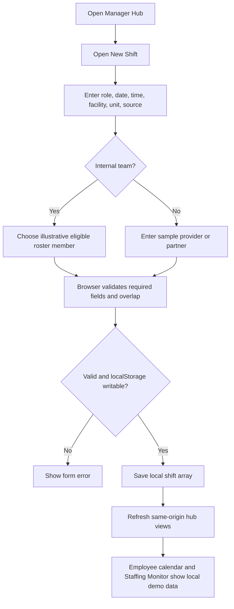
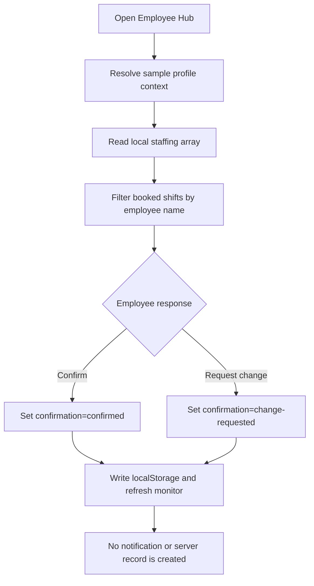
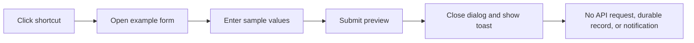
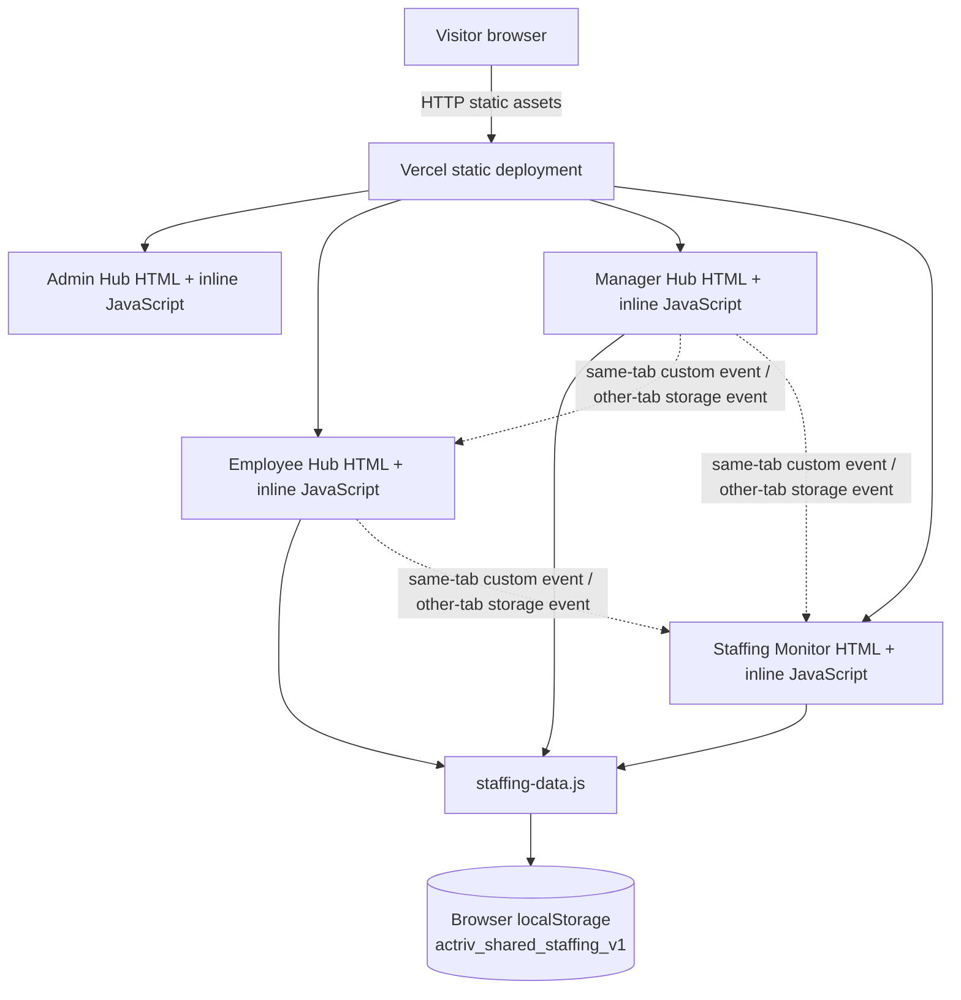
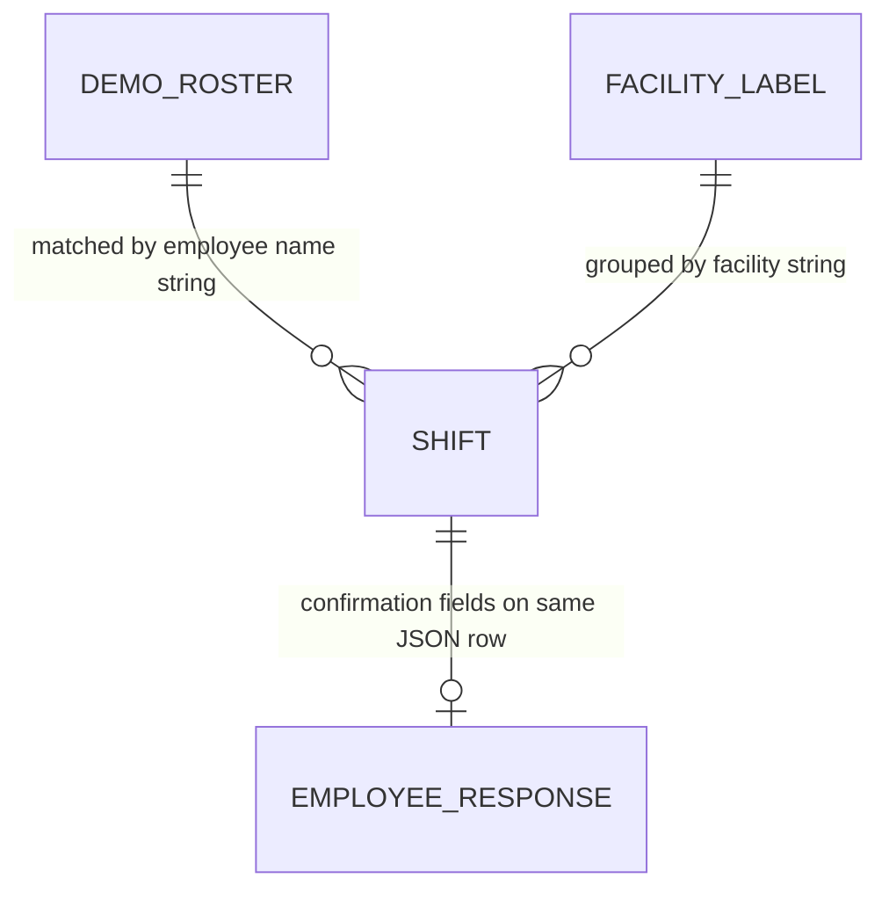

# SYSTEM MASTER OVERVIEW

> **Purpose:** authoritative onboarding, architecture, and operating reference for this repository.
>
> **Audit date:** 2026-11-23<br>
> **Audit scope:** every file in the current project workspace, source-level behavior, and the connected Vercel project/deployment metadata available during this audit.<br>
> **Evidence rule:** source code and deployment metadata describe current behavior; earlier product requests describe intent. This document labels the difference.

## How to use this document

Read Sections A–B for orientation, E–I before changing routes or data behavior, L–N before changing business rules or visibility, and R before any code change. **The static source is the implementation authority.** This document is a map and must be updated when that implementation changes.

## A. Executive Platform Overview

### Platform name

The Admin Hub page title identifies the working product as **Actriv Workforce**. The workspace and Vercel project use the names **Company System Prototype**, **Employee Hub**, **Manager Hub**, and **Staffing Monitor** in different places. There is no separate brand or product specification in the repository that resolves a single canonical name.

### Purpose and problem

The project is an interactive browser prototype for a company workforce platform. It explores how employees, managers, and company administrators could work through people operations, time and attendance, staffing, payroll, benefits, expenses, IT, learning, performance, and related company operations in connected hubs.

The intended problem is fragmented day-to-day employee and workforce work: employees need a personal workspace, managers need staffing and team-capacity tools, and administrators need an operational overview. The source code demonstrates screens and some local interactions; it does **not** currently operate as a real HR, payroll, identity, finance, or scheduling system.

### Intended users

- **Employees:** access a personal Employee Hub, clock preview, resources, and their own assigned staffing calendar.
- **Managers:** use a staffing schedule to book employees or external providers, and open their own Employee Hub profile.
- **Administrators / operations staff:** use the Admin Hub’s company-wide module previews.
- **Staffing observers:** use the cross-hub Staffing Monitor to view schedule coverage and employee responses.

These are product personas and navigation contexts, not authenticated or enforced roles in the code.

### Core value proposition and vision

The product direction is one connected workforce workspace with a distinct personal employee experience, a focused manager staffing experience, and an administrative company-operations experience. The user has also asked for staffing visibility across hubs, manager access limited to manager/employee/staffing views, employee calendars that corroborate assigned shifts, clock in/out and breaks on the dashboard, and a blue/green visual theme.

### Current capabilities

- Four static browser experiences: Admin Hub, Employee Hub, Manager Hub, and Staffing Monitor.
- Client-side navigation and search previews.
- Employee dashboard clock-in, clock-out, and break interactions that calculate a preview duration in memory.
- Manager shift creation, editing, assignment, open coverage, employee-overlap checks, and weekly schedule rendering in the browser.
- Employee schedule confirmation and change-request interactions.
- A staffing monitor with schedule counts, facility coverage summaries, search, and filters.
- Shared demo staffing state through browser `localStorage` on the same origin.
- Static Vercel hosting.

### High-level operation

Vercel serves static HTML and JavaScript to the visitor’s browser. Each hub renders its own page. The Admin Hub and most Employee Hub interactions change only in-memory state. Staffing pages call the shared `StaffingData` utility, which saves a JSON array in the current browser’s `localStorage`. There is no application server, database, API layer, identity provider, or external workforce integration in the audited source.

## B. Platform Scope and Boundaries

### Designed direction

- A broad company system with People, Payroll, Benefits, Time & Attendance, Time Off, Learning, and Performance, plus related finance, recruiting, IT, device, policy, reporting, and automation sections.
- A personal Employee Hub that surfaces employee-appropriate workflows and does not expose another employee’s personal hub by default.
- A Manager Hub for staffing employees and providers into shifts, with the employee calendar available to corroborate assigned dates and times.
- A Staffing Monitor linked from the hubs for schedule and coverage monitoring.
- Permission-aware connections and private employee/payroll/benefit/expense data once real identity and systems are connected.

These are intended capabilities. Their presence in a navigation item or sample card does not mean the backing business workflow exists.

### What the current project does

- Renders static pages and local prototype interactions.
- Shows illustrative records, counts, statuses, and copy in the Admin Hub.
- Stores staffing demo records only in browser-local storage.
- Uses root-relative links between hub routes on one deployment origin.

### What it does not currently do

- Authenticate users, establish employee identity, authorize roles, or enforce record-level permissions.
- Store company records centrally or synchronize data between users/devices.
- Connect to HRIS, payroll, benefits, timekeeping, expenses, accounting, ITSM, identity, provider, credential, calendar, or notification systems.
- Run payroll, move money, submit actual leave/expense/ticket requests, issue app access, execute automations, or send notifications.
- Provide a backend API, database, migrations, scheduled jobs, AI agent, prompt, or workflow engine.

### System boundary

The application boundary ends at static files and local browser execution. Vercel provides hosting and deployment protection controls, but that protection is separate from application identity and authorization. A public share URL or access to a static route does not make the in-app role/profile context secure.

## C. User Types, Roles, and Permissions

| User type / context | Current experience | Code-level permissions | Intended responsibility | Important limitation |
|---|---|---|---|---|
| Administrator / company operator | Admin Hub at `/` and `/admin/` | Can navigate every Admin module and invoke its preview actions | Oversee workforce, finance, IT, policy, and company operations | No login, role check, or server-side access control; routes are directly reachable |
| Employee | Employee Hub at `/employee/`; default profile context is the recruiter sample | Can use page navigation, clock preview, local request previews, and own-name-filtered staffing calendar | Manage own work resources and confirm assigned shifts | Profile is client-side sample context; no authenticated identity or personal data source |
| Manager | Manager Hub at `/manager/`; manager employee context uses `/employee/?profile=manager` | Can manage the shared browser’s staffing schedule and open profile-specific links | Book shifts, review capacity and confirmations, use own Employee Hub view | Manager role is not authenticated; shift and roster data are available to any visitor of the static app |
| Staffing observer | Staffing Monitor at `/staffing/` | Read-only filters and summary view | Monitor bookings, open coverage, and responses | The browser storage is not shared with other users/devices; all records in that browser schedule are visible |

### Intended access boundaries versus actual enforcement

- The Manager Hub navigation omits an Admin Hub link, and the Staffing Monitor does not offer an Admin link. This is **navigation scope only**.
- The Admin Hub contains links to Manager Hub, Employee Hub, and Staffing Monitor. A user who can reach the site can also enter their static URLs directly.
- The manager’s Employee Hub profile is selected from a `profile=manager` query parameter and a hard-coded profile map. Editing the URL can change the context; it does not prove who the visitor is.
- Employee staffing rows are filtered client-side by employee-name string. This is a display filter, not data authorization.
- Do not describe any of these controls as production role-based access control.

## D. Complete Platform Module Inventory

All Admin modules are rendered by functions in `outputs/company-system-prototype.html`. Unless stated otherwise, module data is sample state in the page’s JavaScript object; there are no module APIs, external services, or database dependencies.

### D.1 Admin Hub modules

| Module | Purpose, interactions, inputs, and outputs | Data and dependencies | Status and known gap |
|---|---|---|---|
| Dashboard | Company overview. Shows sample operating balance/activity, task counts, recent invoices, an admin clock preview, and attention items. Refresh and navigation controls update the page or show a toast. | Reads sample arrays and in-memory clock state; links to Tasks, Spend, Invoices, and Time. | **PARTIALLY IMPLEMENTED** as a dashboard preview. Figures are illustrative; refresh does not fetch data. |
| Tasks | Combined task queue with owner, due date, status, and destination module. Add-task form appends a local task; a task can navigate to its configured module. | `state.tasks`; local module navigation. | **PARTIALLY IMPLEMENTED**. No assignment, due-date engine, notifications, filtering workflow, or durable record store. Filter action is a placeholder. |
| People | Sample employee directory with text/type filters, profile detail dialog, add-person form, and export affordance. | `state.people`; new records remain in memory and profile email is demo data. | **PARTIALLY IMPLEMENTED**. No HRIS, lifecycle processing, org chart, secure fields, or CSV export. |
| Recruiting | Sample job/candidate pipeline; new candidate form and “move candidate” stage progression. | `state.candidates`; candidate stages are local array values. | **PARTIALLY IMPLEMENTED**. No applicant system, communications, interviews, offers, or durable workflow. Some role form actions do not persist a record. |
| Payroll | Illustrative payroll preparation progress and pay-run history; opens a sample payroll preview and “mark reviewed” action. | Hard-coded sample amounts, periods, counts, and exceptions; references Time module. | **PARTIALLY IMPLEMENTED** as a preview. Does not calculate payroll, produce pay statements, apply local tax rules, submit a run, or transfer money. |
| Benefits | Illustrative benefit plans and enrollment statuses, with enrollment/configuration controls. | Hard-coded sample plan data; no benefits service. | **PARTIALLY IMPLEMENTED** as a display. Enrollment settings and plan details are placeholder interactions; no employee coverage or elections are saved. |
| Time & Attendance | Local admin clock preview, illustrative team coverage, and timesheets awaiting review. | In-memory clock values and hard-coded schedule/timesheet examples. | **PARTIALLY IMPLEMENTED**. No employee time records, policy engine, real timesheet approval, payroll handoff, device verification, or durable clock data. |
| Time Off | Sample leave requests, policy cards, and office-calendar copy; can show a local request dialog and update a displayed demo decision. | Hard-coded leave rows and labels; no leave balance source. | **PARTIALLY IMPLEMENTED**. Decision is a UI update, not a durable approval; calendar, policy and settings actions are placeholders. |
| Expenses | Sample employee expense activity, filters, new expense form, policy action, and approve/reject controls. | `state.expenses`; submitted examples append to memory. | **PARTIALLY IMPLEMENTED**. No receipt upload, policy evaluation, reimbursement, accounting integration, or export. Decision changes only in-memory state. |
| Invoices | Customer invoice listing, filters, create form, details, and approval/status controls. | `state.invoices`; sample client billing records. | **PARTIALLY IMPLEMENTED**. Status changes are local; no invoicing provider, client delivery, tax validation, payment collection, or money movement. |
| Vendors & Bills | Supplier list and add-vendor/create-bill forms. | `state.vendors`; vendor and bill forms can append local rows. | **PARTIALLY IMPLEMENTED**. No accounts-payable source, bill matching, approvals, payment, or durable supplier records. Vendor detail is not backed by a connected detail view. |
| Cards & Travel | Illustrative spend controls, travel requests, and card activity. | Hard-coded sample rows and policy copy. | **PARTIALLY IMPLEMENTED**. Spend policies and travel requests are placeholders; no bank/card connection or transaction control. |
| Apps & Access | Application catalog, lifecycle-access examples, and access-review presentation; can add a demo app and show an assignment preview. | `state.apps`; role/group options are illustrative. | **PARTIALLY IMPLEMENTED**. No identity provider, provisioning, access revocation, group enforcement, or audit source. Assignment save is preview-only. |
| Devices | Demo hardware inventory, assignment dialog, security posture, and lifecycle actions. | `state.devices` and sample employee list; assignment changes memory. | **PARTIALLY IMPLEMENTED**. No MDM, inventory connector, device enrollment, wipe, security telemetry, or lifecycle ticket. |
| Learning | Course catalog, audience, due dates, progress, and add-course form. | `state.courses`; data remains in memory. | **PARTIALLY IMPLEMENTED**. No LMS connection or completion tracking; assignment/report actions are placeholders. |
| Performance | Illustrative review cycle and team goals, with a new-review affordance. | Hard-coded sample review and goal examples. | **PARTIALLY IMPLEMENTED**. No review workflow, feedback storage, reminders, manager approvals, or goal updates; form does not implement a real review record. |
| Reports & Analytics | Static workforce/spend charts and report listings, with scheduling/open/export affordances. | Hard-coded chart values and samples. | **PARTIALLY IMPLEMENTED**. No analytic query, report generator, scheduled delivery, or CSV export. |
| Automations | Sample workflow rules and event history; add rule and toggle enablement in memory. | `state.automations`; no event engine. | **PARTIALLY IMPLEMENTED**. Toggles change display state only; triggers/actions are descriptive text and are never executed. |
| Policies & Permissions | Sample policy catalog, role matrix, and audit trail. | Hard-coded policy/role examples. | **PARTIALLY IMPLEMENTED**. It documents proposed controls in UI but does not enforce permissions, save policy edits, or emit an audit log. |
| Settings | Company profile, location/calendar examples, connected-service indicators, and governance recommendations. | Hard-coded settings. | **PARTIALLY IMPLEMENTED**. Save/edit/audit actions do not update a settings service; integrations are explicitly shown as unconnected/demo. |

### D.2 Employee Hub modules

`outputs/employee-hub-prototype.html` contains these single-page sections. Sidebar clicks toggle visible sections; they do not navigate to independent APIs.

| Module | Purpose, interactions, inputs, and outputs | Data and dependencies | Status and known gap |
|---|---|---|---|
| Home | Personal greeting, local date, search, time clock, attention/coming-up/shortcut cards, common actions, useful resources, and office information. | Static copy and profile context; clock uses runtime variables. | **PARTIALLY IMPLEMENTED**. Task, holiday, payroll, notifications, and role-resource data are unavailable; the UI labels those states instead of inventing live records. |
| My Resources | Task/request placeholder, role-relevant app/resource links, saved resource examples, and personal profile summary. | Static content and sample profile. | **PARTIALLY IMPLEMENTED**. No assigned-app, task, document, or profile source. Update/open buttons show explanatory dialogs. |
| Pay and Benefits | Personal pay/benefit entry point designed to protect sensitive information in homepage previews. | No payroll or benefits data is loaded. | **PLANNED / PARTIALLY IMPLEMENTED**. Links explain a connection is required; no paystub, balance, enrollment, or pay-date information is available. |
| IT Help | Request-ticket preview and routes to device/app-access help. | Static action labels and local dialog forms. | **PARTIALLY IMPLEMENTED**. Preview submit closes with a toast and sends nothing; no ticket/device/access service. |
| Directory | Profile/directory card and search affordance. Employee context contains only the provided profile and manager context; manager profile is relabeled “My profile.” | Local profile object; no directory API. | **PARTIALLY IMPLEMENTED**. No searchable coworker directory, org chart, skills, email, or Slack link. |
| Expenses | Personal expense form/list entry point. | Local dialog; no live expenses. | **PARTIALLY IMPLEMENTED**. The form is illustrative and does not save, submit, attach a receipt, or request reimbursement. |
| Time Off | PTO request dialog and calendar entry point. | Local form; assigned holiday data is unavailable. | **PARTIALLY IMPLEMENTED**. Preview submit sends nothing; no balance, request record, approval, or assigned office-calendar source. |
| Staffing Calendar | Weekly personal calendar and shift-confirmation list. Previous/next week controls; employee can confirm a booked shift or request a correction. | Shared `StaffingData` module and same-origin browser storage. Filters booked rows by the current employee profile name. | **PARTIALLY IMPLEMENTED**. This is the most connected demo workflow, but it is local to a browser, has no authentication/credential checks, and does not send a manager notification. |
| Company Resources | Handbook, expense/time policies, office guides, and resource search entry points. | Static example destinations and dialog copy. | **PARTIALLY IMPLEMENTED**. No live documents, ownership/last-updated metadata, or permission-aware search. |

### D.3 Manager Hub, Staffing Monitor, and shared subsystem

| Module | Purpose, interactions, inputs, and outputs | Data and dependencies | Status and known gap |
|---|---|---|---|
| Manager Hub — Staffing Schedule | Weekly team calendar, “New shift” modal, shift search/status filter, edit/assign/cancel actions. Inputs include date, role, time, facility, unit, source, employee/provider, and notes. | Uses `window.StaffingData`; available roles/employees come from the hard-coded roster. | **PARTIALLY IMPLEMENTED**. Local scheduling works in the current browser; no server, credential validation, approval, concurrency handling, or notification. |
| Manager Hub — Open Coverage / Shift Bookings | Table shows employee/provider, location/unit, coverage source, booking status, confirmation state, and row actions. Unassigned shifts remain open. | Same local shift array as calendar and monitor. | **PARTIALLY IMPLEMENTED**. “Cancel” deletes the row from local storage rather than recording a cancellation history. |
| Manager Hub — Team Capacity | Counts booked local shifts by roster member and shows sample role/location/credential labels. | Hard-coded demo roster and local shift state. | **PARTIALLY IMPLEMENTED**. Role matches and credentials are illustrative, not authoritative or verified. |
| Staffing Monitor — Summary | Counts booked, open, awaiting/change-requested, and confirmed shifts. | Same `StaffingData` storage on the current origin/browser. | **PARTIALLY IMPLEMENTED**. Counts are local browser data, not company-wide monitoring. |
| Staffing Monitor — Facility Coverage | Groups shifts by facility and calculates a simple booked/total coverage percentage. | Derived from local shift rows. | **IMPLEMENTED** as a local calculation; no target staffing, acuity, provider credential, or real-time external feed. |
| Staffing Monitor — Activity | Search and filter by facility, booking status, confirmation status, employee/provider, role, facility, unit, and source. | Same local schedule data. | **PARTIALLY IMPLEMENTED**. Read-only display has no Admin link, but all rows in the browser store are visible to any visitor who can load the page. |
| Shared staffing utility | Seeds sample shifts; reads/writes schedule JSON; formats dates/weeks; escapes staffing values for HTML; calculates booked hours; dispatches same-tab update events. | `outputs/staffing-data.js`; localStorage key `actriv_shared_staffing_v1`; `staffing:updated` custom event and browser `storage` event. | **PARTIALLY IMPLEMENTED**. Browser-only persistence, no server synchronization, account separation, schema migration, locking, or audit history. |

## E. Navigation and Platform Structure

### Route and page map

The links in the source expect these root-relative paths. Vercel’s latest deployment manifest lists static files corresponding to the app pages; Vercel’s project route API returned no rewrite/redirect rules at audit time.

```text
/                         Admin Hub / Company System dashboard
├── /admin/                Admin Hub duplicate entry page
├── /employee/             Employee Hub (default sample employee context)
│   └── ?profile=manager   Manager's sample Employee Hub context
├── /manager/              Manager Hub (staffing-focused)
└── /staffing/             Staffing Monitor
    └── ?profile=manager   Preserves manager-context Employee Hub link
```

The Vercel deployment manifest reported `src/index.html`, `src/admin/index.html`, `src/employee/index.html`, `src/manager/index.html`, `src/staffing/index.html`, and `src/staffing-data.js`. The deployed UI links use `/`, `/admin/`, `/employee/`, `/manager/`, and `/staffing/`. No local route configuration explains the static file mapping; treat the mapping as deployment behavior to verify if the hosting layout changes.

### Hub navigation hierarchy

```text
Admin Hub
├── Workspace: Dashboard, Tasks
├── People: People, Payroll, Benefits, Time & Attendance, Time Off,
│           Learning, Performance
├── Talent: Recruiting
├── Finance: Expenses, Invoices, Vendors & Bills, Cards & Travel
├── IT & Operations: Apps & Access, Devices, Policies & Permissions,
│                   Automations, Reports & Analytics
├── Settings
├── Help & Support (toast placeholder)
├── Staffing Monitor
├── Manager Hub
└── Employee Hub

Employee Hub
├── Home (dashboard, search, clock, overview, shortcuts, resources)
├── My Resources
├── Pay and Benefits
├── IT Help
├── Directory
├── Expenses
├── Time Off
├── Staffing Calendar
└── Company Resources

Manager Hub
├── Staffing Schedule (weekly team calendar)
├── Open Coverage / Shift Bookings
├── Team Capacity
├── My Employee Hub
└── Staffing Monitor

Staffing Monitor
├── Summary metrics
├── Coverage by facility
└── All staffing activity (search + facility/status filters)
```

Admin Hub and Employee Hub modules are client-rendered within a single HTML page. Manager Hub and Staffing Monitor are separate HTML pages. There are no settings pages behind a real administrative service.

## F. Detailed Feature Behavior

### F.1 Admin navigation, search, and record previews

- Admin module selection uses `data-view` attributes and a `render()` map. The visible content is generated by template-string functions.
- Global Admin search matches the module key/name list and returns module-navigation buttons. It is not a search over company records and does not apply permissions.
- Most sample create forms append to arrays in the JavaScript `state` object. Implemented in-memory append cases include employee, candidate, invoice, expense, vendor, bill, app, device, course, automation, and task.
- Some form types or action buttons open a modal but do not persist meaningful data; unsupported actions use a generic toast or a prototype placeholder.
- Reloading the Admin Hub recreates the initial sample state. There is no `localStorage` persistence in this page.
- Approval-like controls mostly change sample presentation. They do not represent legally effective or operational approvals.

### F.2 Employee Hub search and page navigation

- The sidebar switches among pre-rendered page sections.
- Search uses a hard-coded index of pages and example resources; the search UI does not query an API, employee directory, or policy repository.
- Quick actions open preview dialogs. PTO, expense, and IT forms have browser-side fields but their submit handler closes the dialog and reports that nothing was sent or saved.
- Empty or unavailable states intentionally communicate missing connections. Do not replace them with invented balances, requests, payroll dates, or employee data.

### F.3 Employee clock in, break, and clock out

- Clock in records a JavaScript `Date`, resets break duration, and reveals clock-out/break controls.
- Take break records a break start. End break adds the elapsed interval to an in-memory duration.
- Clock out accounts for an active break, calculates elapsed work/break minutes, hides active controls, and returns the interface to the clock-in state.
- Clock values live only in runtime variables. Reloading clears the active state; there is no time-entry save or payroll handoff.
- The Admin Hub has a separate preview clock with similar but independent in-memory state. The two clock implementations are not shared.

### F.4 Manager shift creation and assignment

1. Manager opens **New shift** or edits/assigns an existing row.
2. The form collects a date, required role, start/end times, facility, unit, source, and notes. Internal team source allows employee assignment; per-diem/agency sources use a provider name.
3. The role selector is generated from hard-coded roster role matches. This is illustrative eligibility only.
4. Browser validation requires form fields and distinct start/end times. The script also rejects identical start/end values and detects overlaps for the same employee/date for the entered interval (including overnight end times on that same date).
5. A row with an assigned employee/provider is stored as `booked`; no assignee is stored as `open`. Newly assigned work starts at `awaiting` confirmation. Editing preserves the prior confirmation only if the assigned person/provider string is unchanged.
6. Save overwrites the full localStorage array, dispatches `staffing:updated`, refreshes the Manager Hub, Employee Hub, and Monitor in the same tab, and causes other same-origin tabs to refresh via the browser `storage` event.
7. Cancel removes the record from local storage. No cancellation event or audit record remains.

Failure conditions are limited to browser-side field checks, overlap checks, and localStorage write failure. There is no server validation, identity check, permission check, transaction, notification, or rollback mechanism.

### F.5 Employee shift corroboration

- Employee Hub derives a profile context from the URL query parameter. The default context maps to the sample employee; `profile=manager` maps to a sample manager profile.
- The calendar selects only rows whose `status` is `booked` and whose `employee` string matches the selected profile name. It sorts by date and start time and displays a seven-day week.
- The employee can select **Confirm shift** or **Request change** for rows not yet confirmed. Confirmation writes a status and note to local storage; a change request writes `change-requested` and a note. A confirmed shift is rendered as confirmed without the response controls.
- The Monitor reads the changed confirmation state on the same browser/origin. No push notification or manager task is created.

### F.6 Staffing monitoring

- The monitor computes counts from all shifts currently in localStorage, summarizes each facility, and renders the activity table.
- Search is substring matching across employee/provider, role, facility, unit, and source. Status filters accept booking and confirmation values.
- A `profile=manager` query changes the Employee Hub link to retain manager context. The Manager Hub’s main **Open staffing monitor** button currently links to `/staffing/` without that query parameter; its navigation links do preserve it. This inconsistent context propagation is a known gap.

## G. End-to-End Workflows

### Manager books an internal shift



### Employee corroborates a booked shift



### Employee preview action (PTO, expense, or IT)



### Admin sample record interaction

Admin selects a module → opens a local modal → browser-required fields are checked → supported form kinds append to the in-memory `state` object → `render()` redraws the current module → a toast confirms a preview-only save. The array resets on reload. Approval and integration actions either update in-memory presentation or show placeholder copy.

### Recovery and failure behavior

- Staffing: malformed/unreadable localStorage returns an empty schedule; a write exception returns `false` and the Manager Hub displays a form error. The utility does not repair malformed state or retain a backup.
- Employee forms: submit is explicitly a preview; values are not retained and there is no retry queue.
- Admin actions: no centralized error handler or API error model exists; unsupported actions fall through to toasts.
- Browser/device loss: local staffing data can be cleared with browser storage and cannot be restored from a server.

## H. System Architecture

### Current architecture



The event arrows represent browser UI refreshes. They do not connect different people’s browsers.

### Layers and boundaries

| Layer | Current implementation |
|---|---|
| Frontend | Plain HTML, CSS, and vanilla JavaScript. Admin, Employee, Manager, and Monitor templates are mostly self-contained. No React/Vue/Angular or component package is present. |
| Application logic | Inline functions and event listeners in each HTML page. The Admin Hub uses a page-local state object; Employee Hub uses runtime variables for the clock and profile context; staffing pages call `StaffingData`. |
| API/backend | None found in the workspace or current deployment manifest. No request handler, server code, API contract, or service boundary exists. |
| Persistence | Browser `localStorage` for staffing demo shifts only. Other changes are in-memory or DOM-only. |
| Database | None. No SQL, Prisma, Supabase, migrations, database client, or policy definitions were found. |
| Authentication | None in application code. Vercel project protection is a separate hosting setting. |
| Authorization | None in application code. Role/profile filtering is client-side and non-secure. |
| AI/automation | No model, prompt, agent runtime, or workflow engine. Admin “Automations” is sample UI with local toggles. |
| Hosting | Vercel project `employee-hub-prototype`; latest deployment metadata at audit showed framework `null`, production target, `READY`, and region `iad1`. No local Vercel config or build manifest is present. |

### Source structure

```text
project root/
├── .git/                               # Local Git metadata; main tracks origin/main
├── outputs/
│   ├── company-system-prototype.html   # Admin Hub and company-wide module previews
│   ├── employee-hub-prototype.html     # Employee Hub and manager employee-profile context
│   ├── manager-hub-prototype.html      # Manager staffing schedule and booking forms
│   ├── staffing-monitor.html           # Read-only staffing summary and filters
│   └── staffing-data.js                # Shared localStorage schedule utility and demo roster
├── work/                               # Empty at audit time
└── SYSTEM_MASTER_OVERVIEW.md           # This document
```

At the source audit, the project root was not a Git repository and `rg --files -uu` found only the five source artifacts. It has since been initialized and connected to `https://github.com/BlackNubi/Canis-Lupus.git`; local `main` tracks `origin/main`, whose existing initial commit contains the repository README. The current `SYSTEM_MASTER_OVERVIEW.md` and `outputs/` files are in a local commit based on that initial history, but the commit has not yet been pushed. No package manifest, AGENTS.md, tests, CI workflow, environment file, API code, database code, or migration was found in the project workspace.

## I. Database and Data Model

### Database status

There is **no database schema** in the project. The structures below describe client-side JavaScript data, not relational tables or durable company records.

### Admin Hub in-memory state

The `state` object in `outputs/company-system-prototype.html` contains arrays/objects for people, candidates, invoices, expenses, vendors/bills, devices, apps, tasks, clock state, automations, and courses. Other screens use hard-coded arrays and computed presentation values. The record relationships are primarily names and strings; there are no stable IDs/foreign keys for many examples. A page reload reconstructs original sample state.

### Staffing browser record

Storage key: `actriv_shared_staffing_v1`.

| Property | Meaning |
|---|---|
| `id` | Local row identifier; seed IDs are static and newly created IDs use a timestamp string. |
| `employee` | Assigned internal employee name; empty for an external provider or open shift. |
| `provider` | Provider/partner display name for an external booking. |
| `role` | Requested job/coverage role. |
| `facility`, `unit` | Facility and unit/department labels. |
| `date`, `start`, `end` | Local date string and 24-hour time strings. |
| `source` | Internal team, per-diem pool, or agency/network label. |
| `status` | `open` or `booked`. |
| `confirmation` | `open`, `awaiting`, `confirmed`, or `change-requested`. |
| `notes`, `employeeNote` | Sample manager/employee text. |
| `sample` | Indicates a seeded sample row. |
| `confirmedAt`, `updatedAt` | Optional browser-generated ISO timestamps. |

### Logical relationship (not a database ERD)



`DEMO_ROSTER`, `FACILITY_LABEL`, and `EMPLOYEE_RESPONSE` above are conceptual labels only. The implementation has no separate tables/entities; confirmation fields are on the shift object.

### Data ownership and lifecycle

- Data is owned by the local browser profile and origin, not by an employee or manager account.
- The shared staffing schedule is read and replaced as one JSON array. There is no migration/version field, record-level transaction, conflict resolution, audit trail, retention policy, or backup.
- The sample roster is a hard-coded constant and contains illustrative role/location/credential strings.
- Staffing date helpers create date strings using local time and format dates at local noon; the week starts Monday. `hoursFor()` sums booked intervals for a matching employee/date and accounts for overnight end times, but no page currently acts as a payroll-grade timesheet source.
- No central validation rules, encryption-at-rest controls, consent/retention controls, or per-user data policies are implemented.

## J. API and Integration Reference

### Application APIs

No HTTP API endpoints or callable backend services were identified. There are no request methods, request/response schemas, API authentication requirements, or server-side error responses to document.

### Local browser interfaces

| Interface | Location | Caller | Behavior |
|---|---|---|---|
| `window.StaffingData` | `outputs/staffing-data.js` | Employee Hub, Manager Hub, Staffing Monitor | Exposes `KEY`, `roster`, `load`, `save`, `dateISO`, `dateLabel`, `weekStart`, `iso`, `addDays`, `escapeHTML`, and `hoursFor`. This is a browser utility, not an API. |
| `staffing:updated` | `StaffingData.save()` | Staffing pages in same tab | Custom DOM event carrying the schedule array; triggers re-rendering in open page contexts. |
| `storage` event | Browser platform | Staffing pages in other same-origin tabs | Re-renders when the staffing key changes in another tab of the same browser profile. It does not fire across different users/devices. |

### External services and deployment

- **Vercel:** static hosting/deployment. Latest project metadata at audit: `employee-hub-prototype`, framework unset (`null`), production deployment state `READY`, aliases included `employee-hub-prototype-two.vercel.app` and `employee-hub-prototype-robert-cbc0.vercel.app`. Vercel returned no Git-linked projects for the team; the deployed production project is not automatically connected to the GitHub repository at this time. This metadata may change after the audit.
- **Vercel protection:** project metadata reported password protection disabled and SSO protection enabled for `all_except_custom_domains`. Protection behavior is hosting-level and may differ by alias/share URL. It is not a substitute for in-app user identity or authorization.
- No live Rippling, ShiftNex, payroll, benefits, HRIS, accounting, identity, IT, calendar, Slack, email, or notification integration was found.
- The source uses root-relative same-origin page links and a local script include. No external script/font/API dependency was identified in the audited artifacts.

## K. AI and Agent Systems

No AI model or AI provider is called by the application. No prompts, agent tools, agent memory, automated decisions, AI moderation, approval gates, or AI failure handling exist in source. The “Automations” module is a local UI preview and does not execute rules. References in product conversation to Rippling AI or benchmarks are external context, not implemented AI architecture.

## L. Business Logic and System Rules

### Current code invariants

1. Do not present Admin sample balances, payroll, task counts, expenses, invoices, leave, course progress, or benefit information as live company records.
2. Employee Hub action copy treats payroll, benefits, directory, IT, company documents, and leave as unavailable until an authorized connection exists. Preserve truthful unavailable/preview states until the corresponding source is real.
3. The Employee Hub clock must be described as a local preview unless a durable, authorized time system is implemented. Break duration is excluded from the preview worked-minute total.
4. Staffing `status` represents open versus booked coverage; `confirmation` represents the employee’s response. They are separate dimensions.
5. A shift with an internal employee/provider assignment becomes `booked`; a shift with no assignee becomes `open`.
6. New assigned shifts start at `awaiting`; employee response may set `confirmed` or `change-requested`. Open shifts use `open` confirmation.
7. Manager role matching is illustrative. The current roster’s `roles` arrays are not verified credentials and must not be used for real clinical assignment decisions.
8. Employee calendar rendering filters to the selected profile-name string and booked status. This does not secure the source data.
9. Staffing updates are only shared among pages using the same origin and browser storage profile. Never claim the localStorage preview synchronizes between actual employees.
10. Manager/Employee/Admin navigation visibility is not a permission boundary. Do not put real confidential data into this public static demo.

### Validation and calculations

- Manager shift form uses required HTML fields and checks date/time presence, distinct start/end, and same-date overlap for a selected employee.
- The overlap check compares the proposed interval with booked rows assigned to the same employee on the **same date**. It does not test adjacent-date/overnight collisions or external provider conflicts.
- Facility coverage percentage is `booked shift count / total shift count for facility`, rounded to an integer. It is a shift-count ratio, not coverage by hours, staffing need, or acuity.
- Admin task counts and dashboard totals are sample-derived or hard-coded; they are not canonical business metrics.

## M. UI/UX and Design System

### Visual direction

- The current source uses a light neutral surface, deep blue/navy navigation and primary controls, and green/teal success accents. This matches the requested blue/green direction more closely than the earlier plum benchmark styling.
- Admin uses a compact desktop operations layout with fixed top bar, left navigation, tables, cards, dialogs, status badges, and blue/green state colors.
- Employee Hub uses a personal dashboard with a persistent sidebar, clear page sections, resource cards, shortcuts, and a prominent clock panel.
- Manager Hub and Staffing Monitor use compact workforce-operation layouts with a weekly calendar, metrics, tables, filters, and dialogs.
- CSS is embedded in each HTML file. Styles are not shared through a token package or common component library; reuse is by visual pattern only.

### Responsive and accessibility conventions

- The pages include viewport metadata and responsive CSS breakpoints/layout changes.
- Source uses semantic headings/sections/nav, labels for many form controls, focus-visible outlines, aria labels/live regions on key dynamic areas, and keyboard interactions for several controls.
- Modal implementations focus an initial control and support close buttons; Admin and Employee Hub listen for Escape. There is no repository-level accessibility audit or automated a11y suite.
- Preserve keyboard access, descriptive controls, contrast, responsive behavior, and truthful status copy when changing the UI. Verify every newly added control has a meaningful accessible name and interaction.

## N. Security and Privacy

### Current controls and gaps

- **Authentication:** none in app source.
- **Authorization/role access:** none in app source. Query parameters and navigation links are not verified by a trusted server.
- **Vercel protection:** deployment-level SSO metadata is configured, but the project also uses shareable URL behavior. A link-based preview is not account-level authorization, and bypass/share tokens must never be copied into this document or committed to source.
- **Data privacy:** no live employee database is connected, but all sample HTML/JS and any localStorage schedule can be inspected by a visitor with page access. Browser storage is not private per in-app role.
- **Sensitive data:** source examples are labeled as samples and use `.test` email domains in Admin demo data. Do not add real pay, health, bank, identity, credential, or employee records to this static public prototype.
- **Input/rendering:** `staffing-data.js` exposes an HTML escaping helper used by staffing renderers. The Admin Hub uses template-string rendering and does not apply a consistent output-escaping layer to all values appended from forms. If real or untrusted user data is introduced, HTML injection/XSS must be addressed before release.
- **Validation:** most business validation is client-side and can be bypassed. Real systems must validate again at a trusted service boundary.
- **Audit:** sample audit rows are static display content; no event/audit log is written.

## O. Current Implementation Status

Status terms:

- **IMPLEMENTED** — behavior exists in this codebase and is complete for its defined local prototype scope.
- **PARTIALLY IMPLEMENTED** — a working local preview exists but intended company workflow, persistence, integrations, security, or operational controls are missing.
- **PLANNED** — stated product direction or a necessary production capability with no implementation found.
- **UNVERIFIED** — cannot be reliably confirmed from this workspace or available deployment metadata.
- **BLOCKED** — prevented by a known dependency or unresolved issue. No product module is explicitly blocked in source; production operation is constrained by missing backend/identity/integrations.

| Capability | Status | Evidence / qualification |
|---|---|---|
| Admin Hub navigation and 20 module screens | PARTIALLY IMPLEMENTED | Static HTML/JS pages with sample state; numerous placeholder actions. |
| Admin sample forms and local interactions | PARTIALLY IMPLEMENTED | Supported forms update page memory only; no reload persistence. |
| Employee Hub navigation, shortcuts, search preview | IMPLEMENTED for navigation preview | Search index is local and static; no content retrieval or permission checks. |
| Employee clock in/out/break | PARTIALLY IMPLEMENTED | Runtime-only time arithmetic; no stored/submitted timesheet. |
| Employee profile-specific manager view | PARTIALLY IMPLEMENTED | Query parameter maps to a hard-coded sample profile; not authenticated. |
| Manager shift scheduling | PARTIALLY IMPLEMENTED | LocalStorage-based CRUD-like UI with limited validation and no server. |
| Employee shift confirmation/change request | PARTIALLY IMPLEMENTED | LocalStorage state update only; no notification or approval workflow. |
| Staffing Monitor metrics/search/filters | IMPLEMENTED for local demo data | Reads same browser-local schedule; not company-wide monitoring. |
| Cross-user/device staffing synchronization | PLANNED | No backend or shared database present. |
| Payroll, benefits, HRIS, ITSM, accounting, identity, LMS integrations | PLANNED | Admin/Employee UI contains sample or unavailable states only. |
| Authentication and role/data authorization | PLANNED | No application identity or permission enforcement present. |
| Database, API, migrations, audit log | PLANNED | None found in workspace/deployment manifest. |
| Production automations and AI | Not implemented | No execution engine, AI provider, prompts, or agent code. |
| Automated tests / CI | UNVERIFIED / absent in workspace | No test files, package manifest, or CI workflow found. |
| Vercel production deployment | IMPLEMENTED as static hosting | Connected project metadata showed latest deployment `READY`; app behavior remains prototype-only. |

## P. Known Issues, Risks, and Technical Debt

1. **No trusted identity or permission layer.** Profile query parameters and hidden links do not limit access. Any accessible static route remains reachable by URL.
2. **No server persistence.** Admin and Employee preview changes reset on reload; staffing changes live only in one browser profile.
3. **Staffing is not multi-user.** Manager assignments and employee responses will not appear on another user’s device. This conflicts with the intended real staffing workflow.
4. **Manager-link context inconsistency.** Manager Hub navigation links preserve `profile=manager`, but its primary “Open staffing monitor” button drops it, so the monitor’s Employee Hub link can return to the default profile.
5. **Sample roster and credentials are not authoritative.** Role eligibility should never drive real provider assignment or clinical coverage.
6. **Limited overlap checking.** Same-date employee overlaps are checked, but adjacent-day overnight collisions and broader staffing constraints are not.
7. **Local deletion without history.** Cancel removes a shift; no audit, cancellation status, actor, or recovery mechanism exists.
8. **Incomplete status persistence.** Some Admin decisions alter only a DOM cell; others alter the in-memory state. Reload behavior is inconsistent across modules.
9. **No consistent form/action contract.** Some generic modal types do not map to a `submitRecord` state update; unsupported actions use placeholder toasts.
10. **No source-of-truth service.** Dates, totals, facility labels, employee identities, policies, and metrics are not reconciled against a company system.
11. **XSS hardening is uneven.** Dynamic Admin form values are inserted into HTML without universal escaping.
12. **Monolithic files.** Large inline scripts and CSS make changes harder to isolate and review; no shared design tokens/components exist.
13. **No tests, CI, or local build manifest.** Reproducible validation and deployment are not established in the workspace.
14. **Deployment protection differs from product permissions.** Vercel SSO/share configuration does not replace application-level access control and may change independently of source.

These risks are recorded for planning. This documentation task did not modify application behavior or remediate them.

## Q. Roadmap and Outstanding Work

### Existing user-stated direction (from product conversation; not a repository spec)

- Retain three distinct experiences: Admin Hub, Employee Hub, and Manager Hub, with Staffing Monitor as a cross-hub view.
- Employee Hub is a personal employee experience, with a manager entering their own profile context rather than seeing everyone else’s employee hub.
- Include a dashboard time clock with clock-in, clock-out, and take/end-break actions.
- Manager staffing should book employees/providers into shifts; employees should corroborate provider shift date/time in their own calendar.
- Expose staffing monitoring through the hubs while keeping the Manager Hub focused on manager/employee/staffing views and not presenting Admin navigation there.
- Support company modules including People, Payroll, Benefits, Time & Attendance, Time Off, Learning, and Performance.
- Keep the blue/green theme.
- User previously requested link-based viewing for “any person with the link.” This is a sharing preference for a prototype, not a permission design for real employee data.

These requests are recorded in conversation history, not in separate requirements/specification files in this project.

### Recommendations inferred from the audit (not user-approved roadmap commitments)

1. **Before real data:** decide identity provider, company/user tenancy, role and record-level permissions, public-share policy, and privacy/audit requirements.
2. **Establish a server data source:** define employee, facility, shift, booking, response, time-entry, leave, and audit models; add migrations and controlled API/service boundaries.
3. **Make staffing multi-user and safe:** server-side role/credential eligibility, facility/time-zone policy, conflict checks across midnight, concurrency control, cancellation/change history, notifications, and manager approval workflows.
4. **Connect source systems deliberately:** HRIS/directory, payroll, benefits, timekeeping, ITSM, identity/app provisioning, expenses/accounting, LMS, calendars, and notification services according to authorized access.
5. **Complete hub workflows:** persist employee requests, balance/approval status, relevant calendars/pay dates, learning assignments, performance cycles, and finance operations.
6. **Harden and modularize:** output encoding, server-side validation, CSRF/session protections where applicable, audit logging, shared UI components/design tokens, error handling, and data-retention policy.
7. **Add repeatable quality gates:** choose a runtime/build workflow, add automated unit/contract/browser tests, CI, accessibility checks, and safe preview/production deployment steps.

Prioritize identity/data authorization and backend boundaries before connecting real employee or financial information.

## R. Development Standards and Agent Operating Instructions

Any AI agent, LLM, developer, or automation modifying this project must follow these rules:

1. Read this document and inspect the relevant source before significant work.
2. Treat the existing code as evidence of current behavior and the conversation-derived requirements in Section Q as intended direction. Do not mislabel plans as features.
3. Review the target module, its entry routes, shared staffing utility, and any other hub that consumes its data before editing.
4. Preserve the distinction between Admin Hub, Employee Hub, Manager Hub, and Staffing Monitor. Do not collapse the manager or employee view into the Admin Hub without an explicit product change.
5. Preserve profile-aware Employee Hub behavior for managers while recognizing it is demo context, not authorization. Do not expose other employee records in a personal view as a shortcut.
6. Keep Admin links out of Manager Hub and Staffing Monitor navigation unless product direction changes. Do not treat that omission as security enforcement.
7. Keep staffing contract fields/statuses compatible across `staffing-data.js`, Manager Hub, Employee Hub, and Staffing Monitor. Update all consumers if a field or transition changes.
8. Preserve honest preview/unavailable labels. Never invent live counts, pay data, benefits, credentials, approvals, or dates.
9. Do not add duplicate data stores, APIs, components, or integrations when an existing boundary can be extended. Document justified architectural changes.
10. Do not remove or replace existing behavior until routes, event listeners, storage keys, and dependent hubs have been checked.
11. Do not add real employee, payroll, health, bank, identity, or credential data to static public files or localStorage demos.
12. Keep keyboard behavior, focus visibility, labels, responsive layout, contrast, and status announcements in UI changes.
13. Validate untrusted values before rendering; do not propagate raw user text into template-string HTML.
14. Do not introduce unnecessary frameworks or architecture. If adding a backend, define its purpose and security boundary first.
15. Do not claim an integration, authorization check, database transaction, notification, or audit event exists unless code and deployment evidence show it.
16. Do not expose credentials, share tokens, private keys, or environment values in code, logs, docs, screenshots, or responses.
17. Test relevant behavior after code changes. Since no test harness is present now, first identify the smallest reliable validation approach and document any manual coverage or limitations; do not imply a test ran when it did not.
18. Update this overview whenever routes, workflow behavior, state ownership, storage, dependencies, APIs, security, deployment, or implementation status changes.
19. Resolve conflicts between user requirements, this document, and actual code before major changes. If a conflict is material, describe it and use the latest explicit user direction.
20. Avoid unrelated refactoring and scope creep.

### Pre-development checklist

- [ ] Read relevant sections of this overview and inspect the actual source files.
- [ ] Identify routes, hub consumers, state owner, storage/events, and affected interactions.
- [ ] Confirm whether the requested behavior is implemented, partial, planned, or uncertain.
- [ ] Check for existing data/API/component before introducing a duplicate.
- [ ] Define privacy/authorization impact if employee or financial data is involved.
- [ ] Record any conflict or assumption that changes the intended product behavior.

### Post-development checklist

- [ ] Validate relevant behavior in each affected hub, including responsive/keyboard behavior where UI changed.
- [ ] Confirm the intended manager/employee/profile and staffing context is preserved across links.
- [ ] Check status transitions, empty/error states, and reload behavior.
- [ ] Confirm dynamic values are safely encoded and no secrets or live personal data were added.
- [ ] Review changes for unrelated scope and regressions in shared consumers.
- [ ] Update this document’s status, architecture, workflow, security, and source references as needed.
- [ ] Report exactly what was verified, what was not, and any remaining limitations.

## S. Glossary and Platform Terminology

| Term | Meaning in this project |
|---|---|
| Admin Hub | Company-wide operations prototype at `/` and `/admin/`, branded “Actriv Workforce” in its page title. |
| Employee Hub | Personal employee-facing static hub at `/employee/`. |
| Manager Hub | Manager-focused staffing and team-capacity prototype at `/manager/`. |
| Staffing Monitor | Read-only schedule, coverage, and response overview at `/staffing/`. |
| Staffing calendar | Employee-specific week view of booked shifts; currently filtered by a profile-name string. |
| Open shift / open coverage | Staffing record with no assigned employee/provider (`status: open`). |
| Booked shift | Staffing record with an assignee (`status: booked`). |
| Confirmation | Employee response state: awaiting, confirmed, or change requested. Separate from booking status. |
| Profile context | Client-side employee fields selected from the URL/default values; not authenticated identity. |
| Sample/demo data | Illustrative hard-coded records and text. Not live company data. |
| Preview action | UI interaction that demonstrates a form or status change without creating an authoritative external record. |
| `StaffingData` | Shared browser utility for schedule seed/read/write/date formatting. Not a backend API. |
| Same-origin | Pages served from the same scheme/host/port; required for their browser localStorage and storage-event behavior to be shared. |
| Vercel share URL | Temporary link-based access mechanism supplied by Vercel for a protected deployment; not an application role or user account. |

## T. Source of Truth and Documentation Governance

### Source precedence

1. **Current implementation:** source files and observable deployment configuration are the authority for what works today.
2. **Explicit product direction:** latest user requirements and existing approved decisions describe intended behavior. In this repository, some requirements exist only in conversation history.
3. **This overview:** a maintained synthesis, not a substitute for inspecting source or a formal API/security specification.
4. **Visual references/benchmarks:** inspiration only; they do not prove the project implements the referenced product’s functionality.

### Maintenance rules

- Update this file in the same change that alters a route, module, workflow, data shape/storage key, integration, API, authorization rule, deployment method, or status classification.
- When writing about a new feature, state whether it is implemented, partially implemented, planned, unverified, or blocked and cite the relevant source path.
- When implementation and this document disagree, inspect source and deployment evidence, correct the documentation, and record any intentional difference or unresolved conflict. Do not quietly use old documentation to override code.
- When a proposal is not implemented, keep it in the roadmap/intended-direction section and do not describe it as operational behavior.
- Remove obsolete material only after identifying what replaced it and checking all hub consumers.
- Never add secrets, access/share tokens, private keys, environment values, or sensitive personal records to this document.
- Prefer concise tables and diagrams for structure; keep the document navigable and useful without requiring access to prior chat history.

### Audit limits

This audit covered all files discoverable in the project workspace and queried the connected Vercel project/deployment metadata. At the initial source audit the workspace had no Git history; it has since been connected to the public GitHub repository, whose initial README commit is the parent of the local project snapshot. The application and overview files are committed locally but have not yet been pushed. The workspace contains no backend, database, tests, package/build manifest, CI workflow, or formal requirements/specification documents. Therefore, production integrations, actual authentication policy outside the returned Vercel metadata, runtime behavior across browsers, and any external systems not represented in the workspace are **unverified**.
